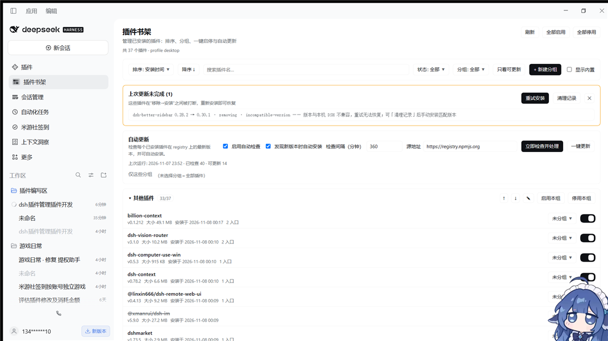

# Plugin Shelf / 插件书架

一个 DSH 第三方 bundle 插件，用来管理**你已经装好的插件**。



## 安装

[](https://www.npmjs.com/package/dsh-plugin-shelf)
[](LICENSE)

四种方式任选其一（装完重启 DSH，侧栏出现「插件书架」）：

1. **从 npm 装**（推荐：npm 来源才能被本插件自己的自动更新接管）：
   ```
   plugin_manager install_bundle target=dsh-plugin-shelf
   ```
2. **插件市场**：在 DSH 的插件市场里搜 `dsh-plugin-shelf` / 「插件书架」，一键安装。
3. **从 GitHub 装**：
   ```
   plugin_manager install_bundle target=github:QYF-888/dsh-plugin-shelf
   ```
4. **本地目录装**（开发时）：
   ```
   plugin_manager install_bundle target=D:\\path\\to\\dsh-plugin-shelf
   ```

> 装到 profile 后若来源是 `file:` / `link:` / `git+` / `github:`，本插件不会把它算作可自动更新项（结果里标 `non-npm-source`），其余管理功能照常。

## 兼容

`dsh >= 0.2.0-rc.1 < 0.3.0`，profile：`desktop` / `web` / `headless`。host 半只依赖 Node 内置模块
（`node:fs` / `node:path` / `node:os` / `node:url`），client 半的 React 由 DSH 浏览器模块表提供，无需打包。

## 功能

| 能力 | 说明 |
| --- | --- |
| 排序 | 按 名称 / 安装时间 / 大小 排序，可切升序降序（下拉是自绘浮层，与面板同风格） |
| 分组 | 任意新建分组；分组可**行内重命名**（✎ → 输入框，输入即生效 / Enter 提交 / Esc 取消）、上下移序、折叠、删除；插件可自由移到某个分组或回到「未分组」 |
| 加插件浮窗 | 分组头「+ 加插件」或新建分组后自动弹出选择浮窗：搜索、全选、清空、勾选后一次加入（加入时自动从原分组移出） |
| 未分组 | 「未分组」也能**行内重命名**、**折叠**（✎ / 折叠箭头都支持），名字与折叠状态会持久化 |
| 筛选 | 状态下拉（全部 / 已启用 / 已停用）、分组下拉（全部 / 未分组 / 单组）、「只看可更新」，与搜索框叠加生效；计数行显示 `命中/总数`，带「清空筛选」 |
| 一键启停 | 每个插件单独开关；每个分组「启用本组 / 停用本组」；顶部「全部启用 / 全部停用」 |
| 自动更新 | 定期查 registry 上的 `latest`（不再用 `pluginManager.inspect`，见下）与本地版本比对；可只检查、也可自动安装；可限定只处理某些分组 |
| 一键更新 | 自动更新卡片右侧「一键更新（N）」：两次点击确认（第一次变「确认一键更新？」，4 秒不点自动复原），随后检查全部 profile 插件并逐个执行 `removeBundle → installBundle`，完成后给出 `成功/总数 · 排队 · 失败` 汇总卡（可 ✕ 关闭） |
| 更新失败处置 | 展示失败原因、`pendingBuilds`（需要放行的构建脚本）+「批准并重试」；`restart-required` 会明确提示 |
| 中断修复 | 「移除→安装」之间被打断会写 journal（`pending-updates.json`），面板顶部显示待修复项并可一键续装；横幅带「✕ 关闭（不删除记录）」与「清理记录」，关闭状态按 `名字@目标版本:阶段` 记账，同一插件再次失败会重新出现 |
| 运行日志 | 每次自动更新的检查数、可更新项、安装结果都落在状态文件里，面板可展开查看 |

## 组成

- `index.js` — host 半：在 `webServer` 上注册一条 **exact** 路由 `/plugin-shelf/api`，负责
  1. 汇总已安装插件（`pluginManager.listBundles()`）并量出 `node_modules` 里每个包的真实磁盘占用与安装时间；
  2. 把分组 / 排序 / 自动更新配置持久化到 `$DSH_HOME/plugin-shelf/state.json`（`saveState` 是**深合并**：只发 `{ui:{ungroupedName}}` 不会清空分组与排序，数组整体替换）；
  3. 执行启停（`setBundleEnabled`）与更新（registry 探测版本 + `removeBundle` → `installBundle('pkg@ver')`）；
  4. 用 `setInterval` 每 60s 检查一次是否到点，到点就跑一轮自动更新（面板关掉也照样跑）。
- `client.js` — 浏览器半：注册 `sidebar.panellist` 侧栏入口与 `main` 页面板，全部数据来自上面那条路由。

## 版本探测为什么不用 `inspect`

`pluginManager.inspect(spec)` 在 registry 分支开头就把「已安装的包」判为 `refused('already-installed')`
（`dsh-plugin-manager/lib/index.js` 里 `known.has(parsed.name)` 直接拒绝），所以对已装插件永远拿不到
最新版本号。本插件改为直接读 npm registry 的 `dist-tags.latest`：

- 默认源 `https://registry.npmjs.org`，面板上可改（写进 `state.autoUpdate.registry`）；
- scoped 包名把 `/` 转成 `%2f`；
- 15s 超时、4 路并发，404 记 `not-found`，401/403 记 `registry HTTP <status>`；
- 结果 reason：`non-npm-source | up-to-date | newer-version | unknown-installed-version | probe-failed: ...`。

## 更新为什么是「移除 + 安装」

本版 DSH 的 `installBundle` 对已安装在 profile 里的包会直接抛 `already-installed`（有 hmr 时
`Object.hasOwn(before, known)` 即失败），没有原地升级。所以一次更新 = `removeBundle` → `installBundle('name@version')`，
全过程写 journal（`$DSH_HOME/plugin-shelf/pending-updates.json`），失败会自动 `rollbackTo(beforeVersion)`；
进程崩溃留下的记录由 `repairUpdates` 续装。

两种已知阻塞及处置：

| 阻塞 | 现象 | 处置 |
| --- | --- | --- |
| `build-blocked` | `installBundle` 返回 `pendingBuilds`（如 `dsh-purge@git+...#<sha>` 需放行构建脚本） | 面板点「批准并重试」→ 写入 `state.autoUpdate.approvedBuilds` → 重试时带 `approvedBuilds`；若首次带审批反而 `stale-approval`，会自动退回不带审批再试 |
| `bundle-in-use` | 插件仍被活进程挂载（`dsh-plugin-manager` 检查 loader entries 的 fiber uid），`removeBundle` 报 `failed: bundle-in-use` | 该插件被**停用并排队**（journal 记 `step:'queued'`，面板提示「重启 DSH 后自动完成」），重启后 `repairUpdates` 完成安装并恢复启用 |

> `pnpm-workspace.yaml` 的 `allowBuilds` 由插件管理器托管，每次安装都会被重写，靠手改文件放行不可靠；
> 批准状态因此存在插件自己的 state 里，由每次 `installBundle` 显式透传。

## 数据与安全

- 状态文件：`$DSH_HOME/plugin-shelf/state.json`（`DSH_HOME` 未设时为 `~/.dsh`），tmp + rename 原子写。
- UI 偏好（筛选条件、未分组名字与折叠）双写：`state.ui.filter / ungroupedName / ungroupedCollapsed`，同时缓存到浏览器 `localStorage['dsh-plugin-shelf:ui-prefs']`；服务端还没加载新版 host（旧 `normalizeState` 会丢掉这几个字段）时以本地缓存为准，重启 DSH 后两端一致。
- journal：`$DSH_HOME/plugin-shelf/pending-updates.json`。
- 路由带同源校验：带 `Origin` 时必须与 `Host` 一致，否则 403；未带 `Origin` 的读取放行。
- 更新只处理 `availability === 'profile'`（真正装进 profile 的包）且来源是 npm-like 的插件；
  `file:` / `link:` / `workspace:` / `portal:` / `git+` / `github:` / `http(s):` 来源会跳过并在结果里标记 `non-npm-source`。
- 面板默认只列 `installed === true` 且 `availability === 'profile'` 的插件，「显示内置」可看到 DSH 自带包（它们不可管理）。

## 自测

```
node test/host-harness.mjs
```

脚本会造一个假 profile（两个假插件），用 stub ctx 挂载真实的 `index.js`，mock `globalThis.fetch`
模拟 registry，然后逐个驱动 `snapshot / saveState / setEnabled / checkUpdates / update / runAutoUpdate /
approveBuilds / repairUpdates` 与跨源拒绝分支，覆盖：

- 正常更新：`removeBundle → installBundle@2.4.0 → applied`；
- 失败更新：`installBundle@9.9.9(failed) → 回滚 installBundle@2.3.0(restored)`；
- 活挂载：`removeBundle → bundle-in-use` → 排队（停用 + journal `step:'queued'`），重启后 repair 完成安装并恢复启用；
- `approveBuilds` 后 `installBundle` 的 options 里带上 `approvedBuilds`；
- `saveState` 深合并：只发 `{ui:{ungroupedName}}` 时分组、排序、自动更新配置全部保留；
- 跨源请求返回 `{"ok":false,"error":"cross-origin request refused"}`；
- effect 释放后路由注销。

## 许可

MIT，见 [LICENSE](LICENSE)。改动记录见 [CHANGELOG.md](CHANGELOG.md)。

